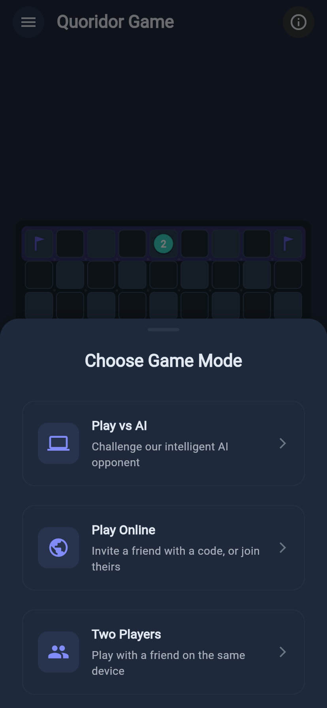
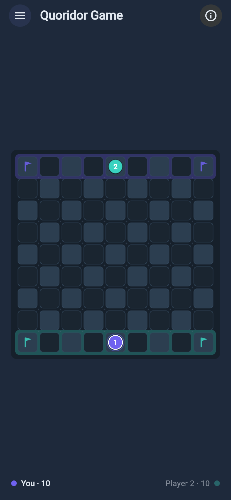
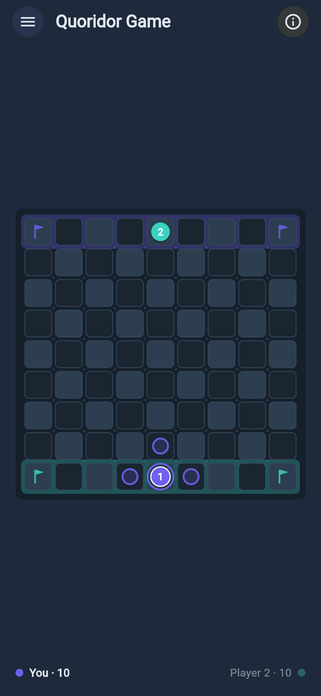
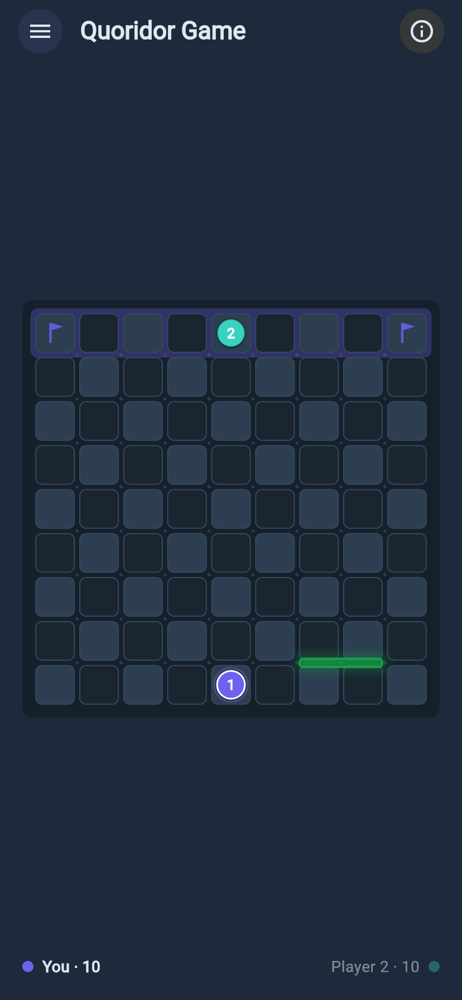
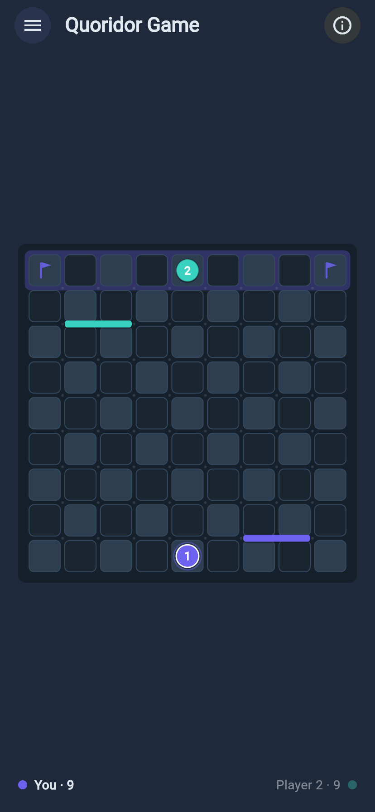
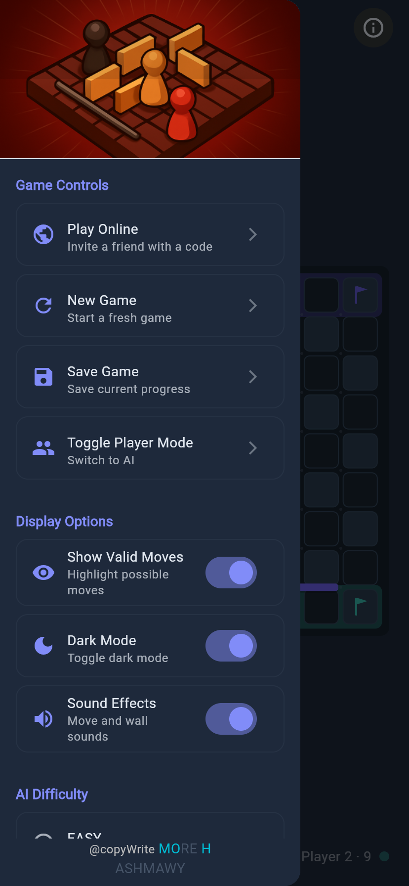

# Quoridor

A Quoridor board game built with Flutter and Flame. Race your pawn to the far
side of a 9×9 board while spending ten walls to slow your opponent down — and
never quite sealing them in, because that is against the rules.

Play against one, two or three AI opponents, with two, three or four people on
the same device, or online with up to four players using a six-character code. In
English and Arabic. Runs on Android, iOS, web, macOS, Windows and Linux from
one codebase.

**[▶ Play it in your browser](https://3shmawi.github.io/quoridor/)** — the web
build is deployed to GitHub Pages from `main` on every push.

[](https://github.com/3shmawi/quoridor/actions/workflows/ci.yml)
[](https://github.com/3shmawi/quoridor/actions/workflows/pages.yml)
[](#)
[](https://flutter.dev)
[](https://flame-engine.org)

> **Store links — please fill these in.** The Google Play URL below is derived
> from the app's `applicationId` and should be correct, but it has not been
> verified. The App Store URL needs the numeric app ID from App Store Connect,
> which is not derivable from this repository.
>
> - Google Play: https://play.google.com/store/apps/details?id=com.MoRe_H.quoridor
> - App Store: `https://apps.apple.com/app/id<APP_ID>` ← replace `<APP_ID>`

## Screenshots

| Choose a game mode | The board | Pawn picked up |
|---|---|---|
|  |  |  |

| Aiming a wall | Walls placed | Settings |
|---|---|---|
|  |  |  |

All screenshots are from the web build, captured at phone size.

## How to play

Quoridor has two moves, and on your turn you pick exactly one of them.

**Move your pawn.** One square up, down, left or right — never diagonally, and
never through a wall. If the opponent's pawn is directly in your way you may
jump straight over it; if something blocks the square behind them, you may step
diagonally around them instead.

**Place a wall.** Each player has ten. A wall is two squares long and sits in
the groove between squares, blocking movement across it for both players. Walls
may not overlap or cross each other, and — the rule that makes the game — a
wall may never leave either player with no path at all to their goal row. It
may only make the journey longer.

You win by reaching the edge on the opposite side of the board. Player 1
starts at the bottom and runs to the top; player 2 does the reverse. With
three or four players, players 3 and 4 start on the left and right edges and
cross the board sideways, everyone has fewer walls, and turns go round the
table. If a pawn is boxed in by the others and its player has no wall they can
place, that player's turn passes; the game says so and moves on. On each turn
the board tints and flags the goal row belonging to whoever is to move, so the
strip swaps ends as play alternates.

### The controls

There are none — the board is the whole interface.

- **To move**, tap your pawn to pick it up. The squares it can legally reach
  are ringed in your colour; tap one to go there. Tapping anywhere else puts
  the pawn back down.
- **To place a wall**, with your pawn down, tap roughly where you want it. The
  wall snaps to the nearest gap and appears green if it can go there, red if it
  cannot. A second tap in the same place puts it down. Aiming slightly nearer
  the other gap turns the wall, so there is no rotate button.

Walls carry the colour of whoever placed them. **Your** goal row is tinted and
flagged in your colour on your turn, and the strip moves to the other end when
the turn passes — so which way you are running is answered without reading
anything.

In the top bar, **undo** takes back your last move (and the computer's reply
to it) in a game on one device, and the **move list** shows every move so far,
in `e2` / `e3h` notation: columns `a`–`i` from player 1's left, rows `1`–`9`
from player 1's end, and walls named by the top-left square of the four they
sit between plus `h` or `v`. A game on one device is kept if the app is
closed, and offered as **Continue game** next time.

Under the board is a single line with each player's name and how many walls
they have left. The player to move stands out and the others fade back, and
their pawn on the board pulses.

Tapping off the board puts down whatever was lined up. An optional turn
timer (15, 30 or 60 seconds, off by default) is in the settings drawer; when
it runs out the pawn takes one step along its shortest route, never a wall.

## Running it

Requires the Flutter SDK (3.32 or newer; the pinned version is in `.fvmrc`).

```bash
flutter pub get
```

### Web — the quickest way to see it

```bash
flutter run -d chrome
```

Or build and serve it as a static site:

```bash
flutter build web --release --no-web-resources-cdn
cd build/web && python3 -m http.server 8080
```

`--no-web-resources-cdn` bundles CanvasKit into the build instead of loading it
from `gstatic.com`. Use it for any self-hosted deployment: it makes the build
self-contained, so it also works on networks that block Google's CDN.

### Mobile and desktop

```bash
flutter run -d android
flutter run -d ios
flutter run -d macos     # or windows, linux
```

### Tests and checks

```bash
flutter test
flutter analyze
```

The Firestore Security Rules have their own suite, run against the emulator.
It needs Node and a JRE:

```bash
cd test/rules && npm install && cd ../..
npx firebase-tools emulators:exec --only firestore \
  --project quoridor-rules-test "cd test/rules && npm test"
```

## Configuration

### The AI opponent

The AI needs no setup and makes no network calls. It is a search over real
shortest-path distances: it looks ahead, values a position by how much shorter
its route is than yours, and considers walls that would actually interrupt your
best route.

Three strengths in the settings drawer, by how far ahead they look:

| Strength | Looks ahead | Plays like |
|---|---|---|
| Easy | its own move | sound but not always the best choice |
| Medium | its move and your reply | blocks when blocking is worth it |
| Hard | four moves | sets walls up a move in advance |

In self-play from varied openings, Hard beat Medium 9–3 and Medium beat Easy
8–4. The search runs on a background isolate (in place on the web), so the
board never freezes while the computer thinks. At a table of three or four,
**Play vs 2 or 3 AIs** gives every other seat to the computer, each playing for
itself.

### Settings

The settings drawer holds theme, language (English or Arabic, which also
flips the layout right to left), sound, valid-move hints, AI strength and the
turn timer. All of them are kept across restarts.

### Firebase

Firebase backs online play and the optional save-and-resume feature and is configured in
`lib/firebase_options.dart`. The game does not wait for it at startup and stays
fully playable if it is unreachable; only online play and saving are
unavailable.

To point the app at your own Firebase project, run `flutterfire configure`.

## Project layout

```
lib/
├── main.dart                    App entry, theming, audio lifecycle, update overlay
├── theme.dart                   Light and dark themes
├── firebase_options.dart        Generated Firebase config
└── flame/
    ├── constants.dart           Board size, seat colours and edges, Position / Wall / GameMove
    ├── board_component.dart     Board rendering, tap handling, turn pulse
    ├── wall_component.dart      Wall and wall-preview rendering
    ├── board/board_metrics.dart Responsive geometry; maps taps to cells and slots
    ├── models/                  Game state, players, online session
    ├── game/
    │   ├── quoridor_game.dart   Flame game loop, turn flow, sound sequencing
    │   └── pathfinding.dart     Route checks behind the wall rule
    ├── services/
    │   ├── game_service.dart    Move validation and execution (pure, no UI)
    │   ├── ai/                  Search engine for the AI opponent
    │   ├── audio_service.dart   The app's sound, behind the setting
    │   ├── audio/               Sfx list, AudioOut interface, the one audio backend
    │   ├── update/              Version info, update checker, web/native split
    │   ├── app_strings.dart     English and Arabic text
    │   ├── settings_service.dart Settings kept across restarts
    │   ├── saved_game_service.dart The local game kept across restarts
    │   ├── identity_service.dart Anonymous identity and chosen name
    │   ├── firebase_service.dart Save / load games
    │   └── online/              Room codes, codec, service, controller
    ├── widgets/update_overlay.dart Update card and forced-update barrier
    └── pages/
        ├── game_page.dart       Game screen, status line, settings drawer
        └── online_lobby_page.dart Create, join and rejoin online games
tool/                            Release scripts and the sound generator
release/                         min_version.txt and release notes
```

`GameService` and the models are pure Dart with no UI or engine dependencies,
so the rules can be tested directly — and reused unchanged by a future
networked opponent. See [`docs/ONLINE_MULTIPLAYER_PLAN.md`](docs/ONLINE_MULTIPLAYER_PLAN.md).

## Security

The values in `lib/firebase_options.dart` are Firebase client identifiers.
Those are designed to be shipped inside client apps and are not secrets, but
they are only safe if your Firestore Security Rules are restrictive. Check your
rules before making a fork public.

## Online multiplayer

Play friends on other devices. **Play Online** opens the lobby: pick two,
three or four players and you get a six-character code; share it and the
others join with it. The game starts once every seat is filled. Games in
progress can be rejoined from the same screen, and tapping your name there
changes what the others see.

Each player sees the board from their own side, with their pawn starting at
the bottom. While it is someone else's turn the board dims and cannot be
touched.

When a game ends, **Rematch** starts a new game for the same table: the first
to tap it creates the game, and everyone else is offered a **Join** button.

The code alphabet leaves out `I`, `L` and `0`, and the join field folds a typed
`0` onto `O` and `I` or `L` onto `1`, so a code read aloud over the phone still
works.

Resign and draw are not built yet — see the plan for what is and is not done.

The Security Rules check what each move does to the board as far as rules can
without a path search: only the mover's own pawn or walls change, a step covers
one or two squares, a wall costs one and lands in bounds, walls and history
only grow, the turn passes on, and only a pawn on its goal edge ends the game.
Whether a wall seals someone in, or a step runs through a wall, is still
checked by the client.

Once a change reaches `main` and both test suites pass, CI deploys the
Security Rules itself (the **Deploy Firestore rules** job), provided the
`FIREBASE_SERVICE_ACCOUNT_JSON` secret is set; without it the job is skipped
with a warning. Until the rules are live, online play is refused. To deploy
by hand, or to deploy the indexes, which CI leaves alone:

```bash
firebase deploy --only firestore:rules,firestore:indexes --project quoridor-290f6
```

Anonymous authentication must also be enabled in the Firebase console
(Authentication → Sign-in method → Anonymous).

See [`docs/ONLINE_MULTIPLAYER_PLAN.md`](docs/ONLINE_MULTIPLAYER_PLAN.md) for
the architecture, the Firebase/Supabase decision, the stored data model, and
what is and is not built.

## Releases

Everything is in GitHub Actions:

- **CI** (`ci.yml`) — format, analyze, test and a web build on every push and
  pull request, plus the Security Rules tests.
- **Pages** (`pages.yml`) — every push to `main` is tested, then deployed to
  the web with a `latest.json` the app reads to spot a newer build: on GitHub
  Pages, and on Cloudflare Pages (project `quoridor`) when the
  `CLOUDFLARE_API_TOKEN` secret is set, a token with only
  **Cloudflare Pages: Edit**.
- **Rules deploy** (part of `ci.yml`) — every push to `main` that passes the
  tests puts `firestore.rules` live, using `FIREBASE_SERVICE_ACCOUNT_JSON`.
- **Bump version** (`bump.yml`) — run it from the Actions tab and pick patch,
  minor or major. It commits the new version and pushes a `vX.Y.Z` tag.
- **Release** (`release.yml`) — on that tag: builds Android, Linux, Windows
  and macOS and publishes them with `latest.json` as a GitHub Release.
  Signing, Google Play (internal track) and TestFlight run only when their
  secrets are set; otherwise those steps are skipped with a note. With
  `BUTLER_API_KEY` set, every build that finished is also pushed to
  [itch.io](https://3shmawiii.itch.io/quoridor) with butler, one channel per
  platform (`html5`, `windows`, `linux`, `mac`, `android`). The web zip
  plays from any folder, as itch.io needs; mark the `html5` upload as
  "played in the browser" once on the itch.io dashboard.

Secrets are pushed from your own machine with `tool/setup_secrets.sh`. It
reads the values all your apps share from `~/.app-secrets/shared.env`
(created as a template on first run), generates this app's Android upload
keystore once in `~/.app-secrets/apps/<repo>/`, and sets every secret with
`gh`. Run it with `--dry-run` first to see what it would set. Back up
`~/.app-secrets/`: Google Play needs the same upload key for every update.

For the rules deploy, create a service account in the Google Cloud console
for project `quoridor-290f6` (IAM & Admin → Service accounts) with the roles
**Firebase Rules Admin** and **Service Usage Consumer**, download a JSON key,
and save it as `~/.app-secrets/apps/quoridor/firebase-service-account.json`
before running the script. The key can change your production rules, so
give it no other roles.

Installed apps and open browser tabs check for a newer build at start and
when they come back to the foreground, and offer it in a card at the top. To
force an update, because old builds would actually break, put the oldest
working version in `release/min_version.txt`.

## Roadmap

- [x] Local two-player and AI games
- [x] Responsive board that scales to the device
- [x] Wall placement with live validity feedback
- [x] Online groundwork: identity, data model, Security Rules, game service
- [x] Online lobby: create, join by code, rejoin, presence
- [x] Three and four players, on one device and online
- [x] Arabic, kept settings, per-turn timer
- [x] In-app update notice and automated releases
- [x] Undo, move list, continue after closing the app
- [x] AI at tables of three and four; distinct strengths
- [x] Online rematch; board checks in the Security Rules
- [ ] Resign and draw
- [ ] Public matchmaking
- [ ] Server-authoritative move validation (paths and walls in the way)
- [ ] Ranked play

## Credits

Built by [@3shmawi](https://github.com/3shmawi) (MoRe H. Ashmawy).
